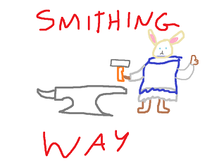

# Smithingway

Smithingway is a plugin for Dalamud that allows you to rename items, give them flavor text, and share those items with other players through trading, linking them in the chat or examining players. This plugin is mainly focused at roleplayers, and as such does not change any other properties about those items. 

# Dev note:
Sharing items with other players is currently dependant on a self-hosted server, as I've yet to go through the syncing implementation of other plugins and do not currently have any servers running for this. 